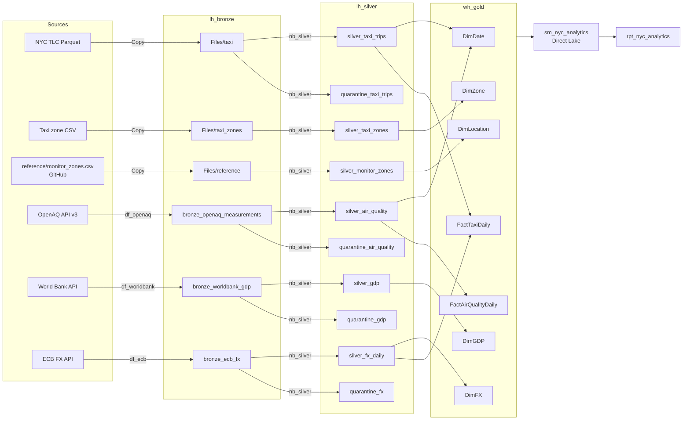

# Lineage

The flow as built. Item and table names come from `config/sources.json`. Everything runs in one
pipeline, `pl_daily` (daily at 06:00 Tashkent time, see [governance.md](governance.md#refresh-schedule)).

## Steps and the code behind them

| Step | Item | Code in the repo |
|---|---|---|
| Source → Bronze files | `pl_daily` Copy activities | `fabric/pl_daily.DataPipeline/pipeline-content.json` |
| Source → Bronze tables | Dataflows Gen2 `df_openaq`, `df_worldbank`, `df_ecb` | `fabric/df_*.Dataflow/mashup.pq` |
| Bronze → Silver | notebook `nb_silver`, rules in `nb_lib_*` | `fabric/nb_silver.Notebook/`, `fabric/nb_lib_*.Notebook/` |
| Silver → Gold | stored procedures `load_*` (order: `gold.load_procedures`) | `fabric/wh_gold.Warehouse/dbo/StoredProcedures/` |
| Gold → report | semantic model (Direct Lake), report | `fabric/sm_nyc_analytics.SemanticModel/`, `fabric/rpt_nyc_analytics.Report/` |

## Row reconciliation (2026-11-20, months 2024-01 … 2024-06)

| Check | Result |
|---|---|
| Bronze taxi rows = `silver_taxi_trips` + `quarantine_taxi_trips` | 20,237,796 + 94,297 (assert in `nb_silver`) |
| `SUM(FactTaxiDaily.trips)` = non-void rows in `silver_taxi_trips` | 19,791,824 = 19,791,824 |
| `FactAirQualityDaily` rows = `silver_air_quality` rows | 4,271 = 4,271 |
| Facts without a matching dimension row | 0 for every key |

Columns added on the way for tracing: `source_file` and `load_ts` (taxi, from Spark file metadata),
`source` and `load_ts` (API tables, from the dataflows), `reject_reason` (quarantine tables).
